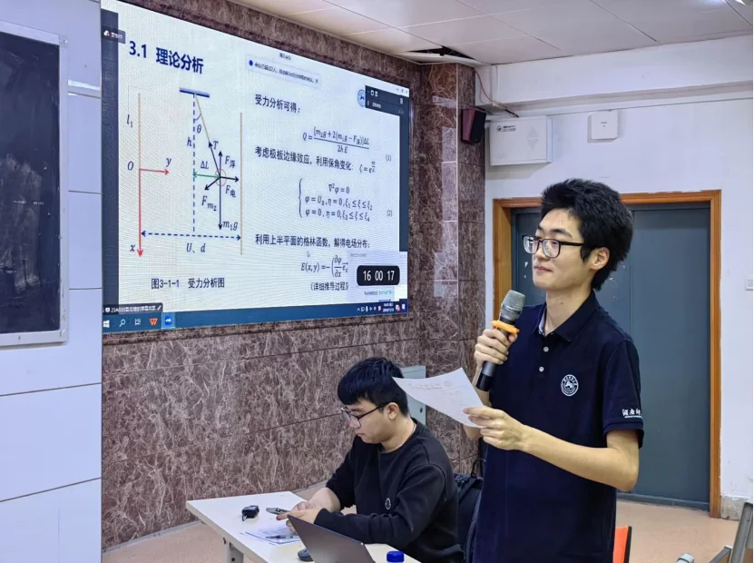
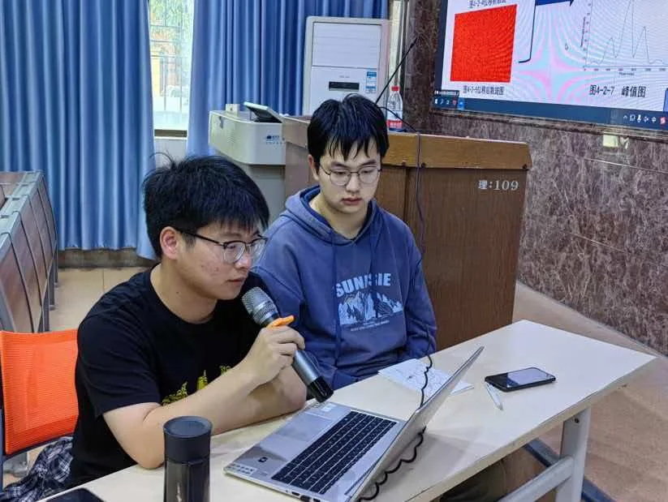
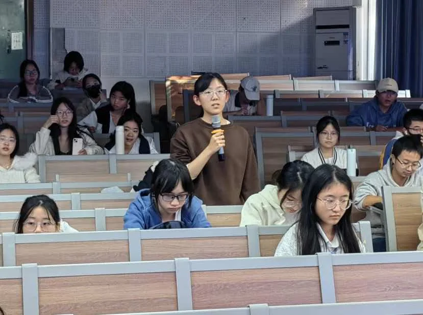

> [!abstract] 摘要
> 2024 年 11 月 10 日下午，致知科学社在理学院 325 举办社团首届 CUPT 表演赛。易佳雄、姚川森、谢临沁三位队员完整演示了 CUPT 的比赛流程。

2024 年 11 月 10 日 14:30–16:30，物理与电子科学学院致知科学社在理学院 109 举办社团首届 CUPT 表演赛。活动以观摩学习为目的，让同学们了解 CUPT 的赛制与辩论形式，学习科研技巧和语言辩论技巧。

## 关于 CUPT

中国大学生物理学术竞赛（China Undergraduate Physics Tournament，CUPT）采用团队辩论形式，注重培养创新精神、团队协作、表达交流与问题解决能力。赛制模拟 IYPT，题目通常没有固定答案，鼓励开放思维。每年 5–6 月，中南赛区组织地区赛，选拔全国赛参赛名额。

## 活动信息

| 项目 | 内容 |
| :--- | :--- |
| 时间 | 2024 年 11 月 10 日 14:30–16:30 |
| 地点 | 理学院 325 |
| 主控队员 | 易佳雄、姚川森、谢临沁 |
| 参与教师 | 单葳 |
| 参与人员 | 致知科学社 |

## 现场：完整演示比赛流程

当天下午，理学院 109 教室的黑板上写着“CUPT 表演赛”和题目。易佳雄、姚川森、谢临沁三位主控队员依次演示了从主持人宣布题目到正方总结发言的完整流程；单葳老师参与活动。表演赛还原了真实、紧张的比赛场景，让观众直观看到 CUPT 的辩论流程。

### 赛制流程

表演赛按 CUPT 流程推进，由主持人宣布正方挑战题目。十个步骤可归为以下五个阶段，括号内为各环节时限。

1. **准备与立题。** 主持人宣布正方挑战题目（1 分钟）；正方准备（1 分钟）。
2. **正方报告。** 正方作报告（1 分钟）。
3. **反方质询与报告。** 反方对正方提问、正方回答（2 分钟）；反方准备（2 分钟）；反方报告最多 3 分钟，随后正反方展开讨论，报告与讨论合计 13 分钟。
4. **评论方环节。** 评论方提问、正反方回答（3 分钟）；评论方准备（2 分钟）；评论方报告（4 分钟）。
5. **正方总结。** 正方总结发言（1 分钟）。

## 国赛背景

据了解，我校在 2022 届获国家三等奖，2023 届获国家二等奖；2024 年 8 月 19–22 日，我校代表队从 68 支入围队伍中获得二等奖，2022 级物理学专业易佳雄获“最佳正方奖”，学校代表队同时获得 2025 年全国竞赛直通资格。

此次表演赛按 CUPT 流程完整展示了报告、质询与讨论环节，让社团成员得以直观了解这项赛事。

## 现场照片

以下为活动现场照片。

## 观赛反馈

现场氛围浓厚，同学们观赛热情高涨。通过观摩，同学们了解了 CUPT 的比赛方式与流程，也接触到课本之外的知识和仿真模拟软件。活动激发了同学们的科研兴趣，开拓了视野。

## 参考资料

1. [社团集结号｜赛事速报 CUPT表演赛精彩来袭！](https://mp.weixin.qq.com/s?__biz=MzIwNjI3NzgwNQ==&mid=2650345950&idx=1&sn=2a5270308dc1493e984e3b6813872750)，微信公众号。
2. [《科学魅力·CUPT 表演赛》](https://mp.weixin.qq.com/s?__biz=MzIwNjI3NzgwNQ==&mid=2650346643&idx=3&sn=6025ba9db1046eee2acb7ef5662a960f)，微信公众号同场报道。
