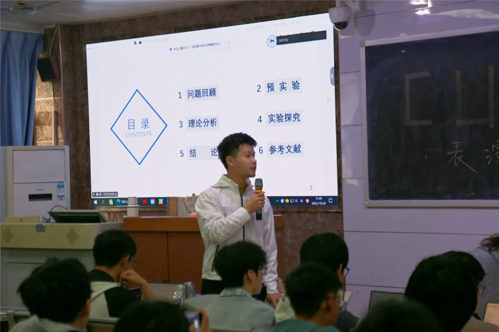
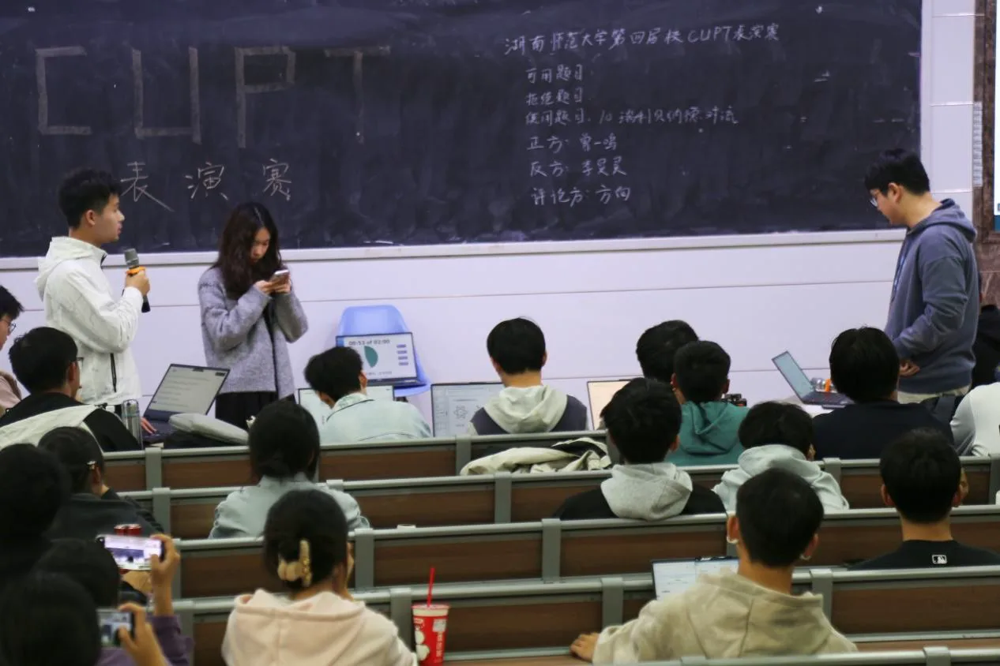
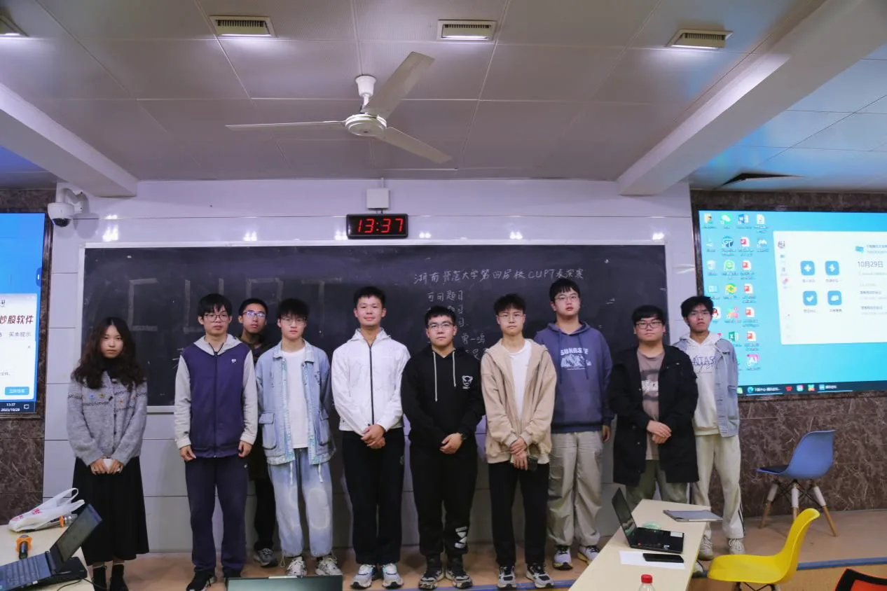

10 月 29 日中午，致知科学社于格物楼 109 教室举办 CUPT 表演赛。活动以经典物理课题为切入点，邀请物电学院的学子们共同开启一场思维与视觉的双重盛宴。此次活动由社团负责人刘昱辰统筹策划。

此次表演赛选取 CUPT 2025 第 10 题「瑞利-贝纳德对流」作为题目，深入探讨当流体上下表面产生温度差时，原本静态的导热过程会转变为细胞状对流胞这一物理现象。这一规律在大气环流、天体物理等领域均有着深远的应用。

表演赛严格复刻 CUPT 竞赛流程：参赛团队以理论建模为基础、以实验演示为助力，通过严谨的推导、可视化的实验以及激烈的辩论，逐步剖析温度差、流体黏度等因素对对流现象的影响，展示了研究一道题目的基本思路与比赛全貌。

赛后，观众围绕赛题研究、比赛流程等方面向参赛老队员发问，队员耐心予以解答，并分享比赛经验。刘昱辰期望借助这场兼具深度与观赏性的赛事，打破学科间的壁垒，使各专业学子都能体会到物理与生活的紧密联结，于校园中播下科学探索的种子。

## 现场照片

