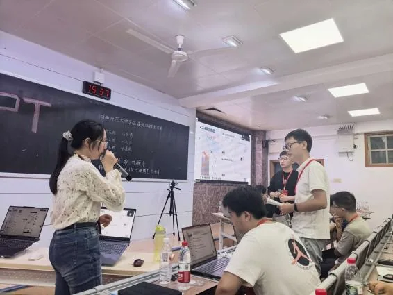
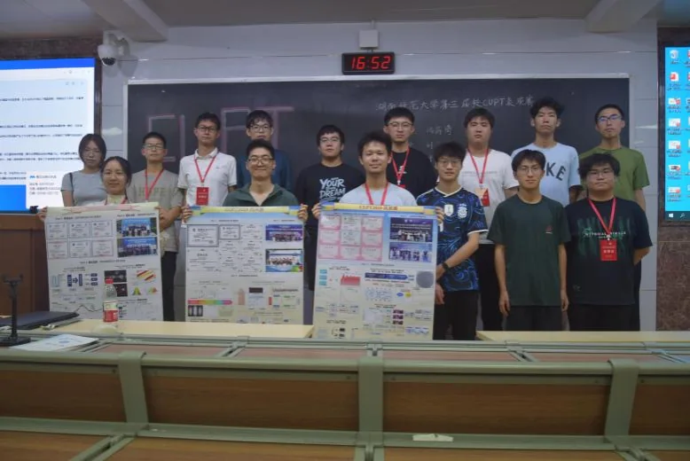

10 月 17 日下午，物理与电子科学学院致知科学社于格物楼 109 教室举办湖南师范大学第三届校 CUPT 表演赛。来自 2025 级物理四班的冯蒋琦、周光召班的刘天宇和叶嘉毅分别作为正方、反方、评方参与此次表演赛，2026 级部分本科生到场观赛。

此次表演赛选取「秋叶硬币」作为赛题，要求研究硬币在充满液体的水箱中沉降至底部的运动及其参数依赖，相关规律在流体力学等领域有广泛应用。正方以理论建模为基础，并借助荧光素钠试剂呈现硬币周围的流场特征；反方依次进行问题回顾、报告总结与优缺点分析，并针对正方的报告提出质询。

比赛严格复刻 CUPT 竞赛流程，正、反、评三方围绕赛题展开讨论，评方作总结发言。从理论建模、实验展示到质询与总结，三个角色在有限的时间里完成了一轮完整的学术辩论。赛后，观众围绕赛题研究、比赛流程等方面向参赛队员发问，队员耐心予以解答，并分享比赛经验。

本次表演赛特邀姚川森、于琪博艺、徐柏清担任评委，三位评委分别对比赛进行了点评，姚川森还预告了接下来的 PT 学术沙龙。对到场观赛的 2026 级同学来说，这场比赛让 CUPT 从纸面规则变成了一次可以跟随的现场演示。

## 现场照片

