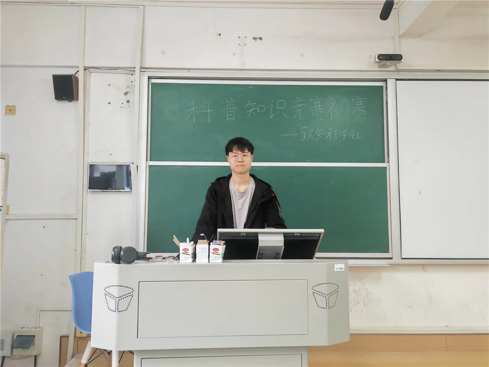
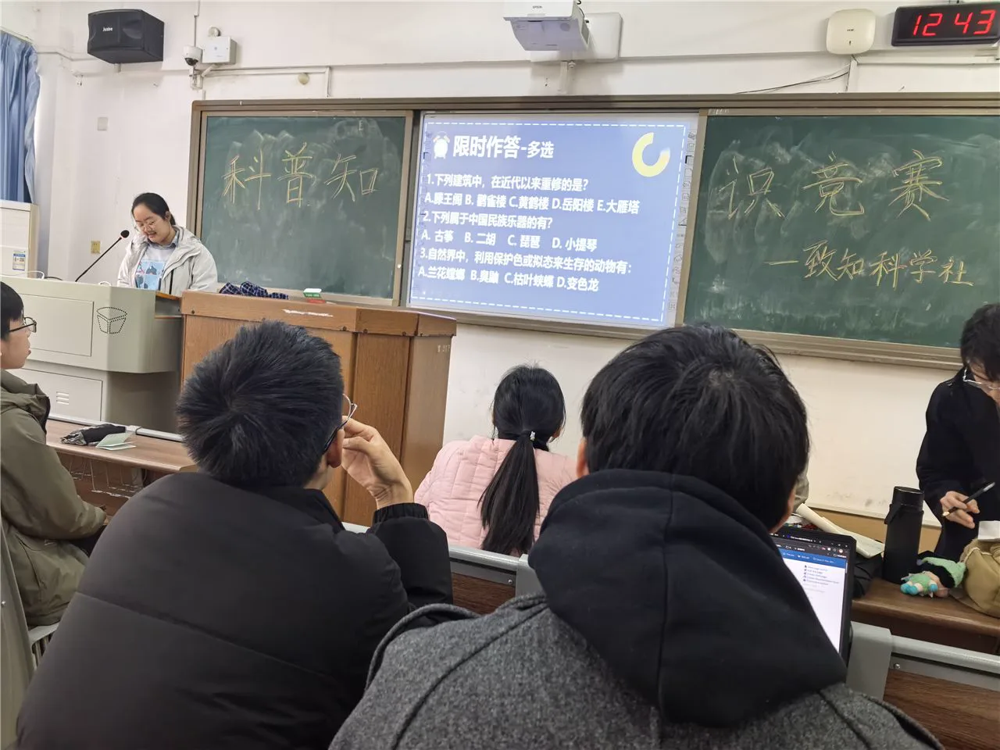
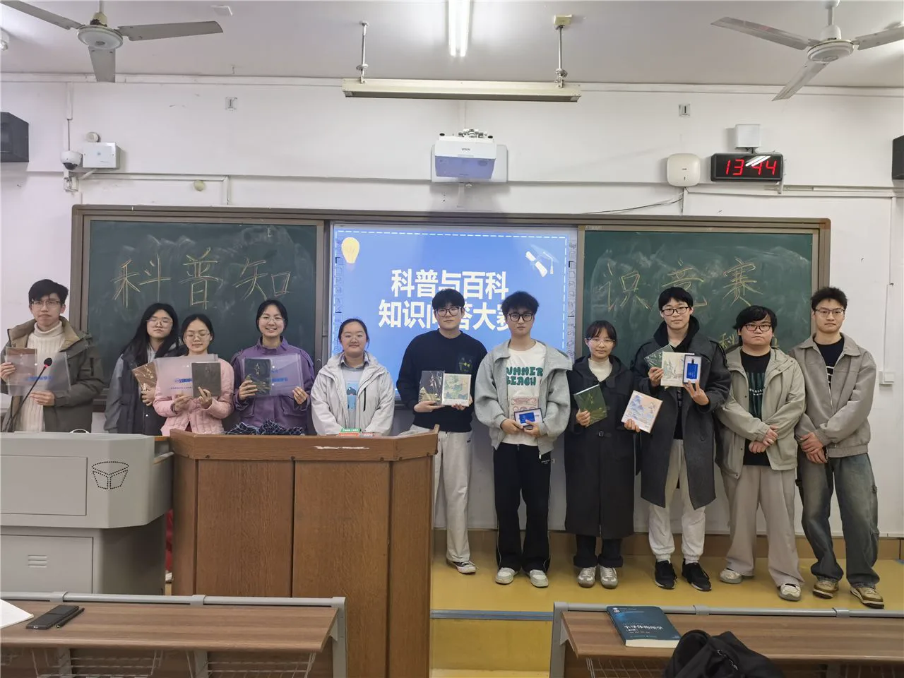

3 月 26 日至 3 月 27 日，致知科学社在格物楼 219 和 217 分别开展了科普知识竞赛活动的初赛与决赛。初赛、决赛分别由刘昱辰、谭淼担任主持人。

初赛阶段，主持人在宣读完规则后，比赛正式拉开序幕。每位参赛选手都全力以赴，认真作答。比赛结束后，由综合评定选拔出的十六位选手进入复赛。

复赛环节精彩纷呈，参赛选手在十六进八的限时作答、八进四的自主选题（艺术音律、衣食行、体育竞技、自然世界、天文地理、物理化学）以及四进二的线索抢答环节中均有出色表现，同时台下观众也积极参与到连线抢答环节中。比赛完成后，由社团理事邓湘源、王璨分别为前四名同学及获得优胜奖的同学颁奖。

此次科普竞赛活动充分展示了全校学生的知识储备，丰富了课余生活，推动了科普工作走深走实，有利于科学知识的传播。

## 现场照片

